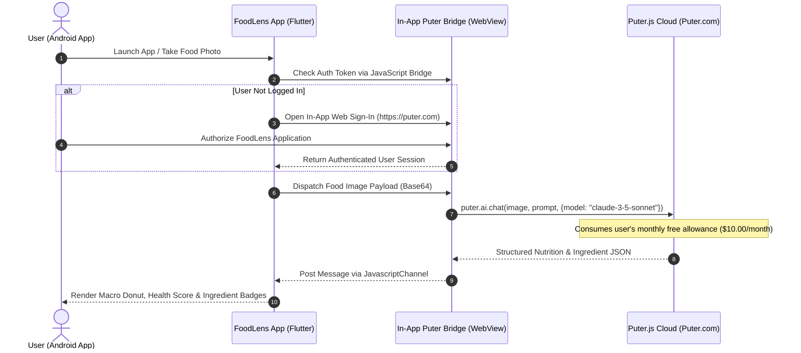

<div align="center">

# 🥗 FoodLens

### *Global AI-Powered Food Intelligence, Computer Vision Nutrition Analysis & Automated Meal Planning*

[](https://github.com/CodeByArnob/FoodLens/releases/latest)
[](https://github.com/CodeByArnob/FoodLens/releases/download/v1.0.0/app-release.apk)
[](https://github.com/CodeByArnob/FoodLens/actions)
[](https://flutter.dev)
[](https://dart.dev)
[](LICENSE)
[-3DDC84?style=for-the-badge&logo=android&logoColor=white)](https://android.com)
[](https://github.com/CodeByArnob)

<br/>

<a href="https://github.com/CodeByArnob/FoodLens/releases/download/v1.0.0/app-release.apk">
  
</a>

<br/><br/>

<p align="center">
  
</p>

*Empowering healthy living through instant visual food recognition, clinical macronutrient tracking, allergen safety screening, and decentralized client-side AI computing.*

</div>

---

> [!IMPORTANT]
> ### 🤝 FoodLens Open Source Contributions — Help Wanted!
> 
> **Puter.js Login, Google Sign-In, OAuth Callback এবং Session Persistence সমস্যার সমাধানে অভিজ্ঞ Developer-দের আমন্ত্রণ।**
> 
> We are actively inviting global developers to collaborate on FoodLens! We are particularly seeking contributions in the following domains:
> - 📱 **Flutter / Dart Development**: Reactive Riverpod state resilience, high-fps UI animations, and charting.
> - 🔐 **Android Authentication & Google OAuth**: Resolving Google's `disallowed_useragent` restriction in embedded WebViews, implementing Chrome Custom Tabs, or configuring native `google_sign_in` token exchange.
> - ⚡ **Puter.js Integration**: Enhancing the headless JavaScript bridge, optimizing quota monitoring, and ensuring persistent session restoration.
> - 📸 **AI Food Recognition**: Refining vision prompts, prompt tuning, and packaged FDA/EU label OCR precision.
> - 🌐 **Localization & RTL**: Expanding authentic translations for Bengali (বাংলা), Arabic (العربية RTL), Hindi, Spanish, French, German, and Japanese.
> 
> 🔗 **Active Help Wanted Issue**: [Investigate and Fix Puter.js Authentication & Google Sign-In](https://github.com/CodeByArnob/FoodLens/issues/1)  
> 📖 **Troubleshooting Architecture Guide**: [`documentation/AUTHENTICATION_TROUBLESHOOTING.md`](documentation/AUTHENTICATION_TROUBLESHOOTING.md)  
> 🛠️ **Contributor Guidelines**: [`CONTRIBUTING.md`](CONTRIBUTING.md)

---

## 📑 Table of Contents

- [Overview & Vision](#-overview--vision)
- [Key Features](#-key-features)
- [Genuine Application Screenshots](#-genuine-application-screenshots)
- [Puter.js User-Pays Architecture](#-puterjs-user-pays-architecture)
- [Authentication Troubleshooting & Open Challenges](#-authentication-troubleshooting--open-challenges)
- [Supported Languages & Regional Currencies](#-supported-languages--regional-currencies)
- [Technology Stack](#-technology-stack)
- [Architecture & Directory Structure](#-architecture--directory-structure)
- [Installation & Local Setup](#-installation--local-setup)
- [Building & Installing the Release APK](#-building--installing-the-release-apk)
- [Testing & Quality Assurance](#-testing--quality-assurance)
- [Open Source Contributions](#-open-source-contributions)
- [Food Safety & Medical Disclaimer](#-food-safety--medical-disclaimer)
- [Author & Community Credits](#-author--community-credits)
- [License](#-license)

---

## 🌟 Overview & Vision

**FoodLens** is an open-source, production-grade mobile food intelligence platform developed natively with Flutter and Dart. Designed to eliminate guesswork from daily nutrition and dietary management, FoodLens lets users point their phone camera at any prepared meal, grocery item, packaged food label, or restaurant menu to immediately extract comprehensive nutritional metrics, macronutrient splits, micronutrients, allergen alerts, and health quality scores.

Unlike traditional calorie-counting apps burdened by paywalls, centralized cloud tracking, and hefty server infrastructures, FoodLens implements a **decentralized, privacy-first User-Pays computing model** powered by **Puter.js**. Users authenticate with their own personal cloud allowance, ensuring complete data ownership, zero recurring developer hosting costs, and uncapped global availability.

---

## ✨ Key Features

### 🔍 1. Real-Time Multimodal Vision & OCR Scanner
- **Prepared Meal Identification**: High-accuracy visual recognition of complex multi-ingredient dishes (e.g., *Grilled Salmon Bowls, Margherita Pizza, Lentil Dal, Avocado Toast*).
- **Packaged Food Label OCR**: Automated scanning and extraction of FDA / EU Nutrition Facts panels (Calories, Saturated Fat, Sodium, Dietary Fiber, Sugars, Cholesterol, Potassium).
- **Restaurant Menu Parsing**: Extracts dish names, ingredients, localized pricing, and dietary suitability flags directly from printed or digital paper menus.
- **Confidence Rating**: Real-time transparency badge distinguishing between verified nutritional labels and AI visual estimations.

### 📊 2. Clinical Nutrient Intelligence & Food Scoring
- **Dynamic Macronutrient Distribution**: Interactive donut charts visualising Protein, Carbohydrate, and Fat proportions using `fl_chart`.
- **Micronutrient Tracking**: Deep visibility into Sodium, Fiber, Potassium, Calcium, Iron, and Vitamin C levels.
- **Health Score & Quality Rating**: Algorithmic scoring scale (1–100) and grade ranking (A+ to F) evaluating nutrient density, glycemic impact, and processed ingredient levels.
- **Dietary & Allergen Safety Alerts**: Automatic checks for Gluten, Dairy, Peanuts, Tree Nuts, Eggs, Soy, Shellfish, Halal, Kosher, and Vegan criteria.

### 📅 3. Smart Daily Meal Planner & Hydration Tracker
- **Calorie-Target Regimens**: Tailors daily breakfast, lunch, dinner, and snack meal plans to custom daily caloric budgets (e.g., 2,100 kcal/day).
- **Dietary Strategy Modes**: Instant one-tap regeneration for *Balanced*, *High-Protein*, *Keto*, and *Vegan* nutritional regimes.
- **Hydration Logging**: Quick-add hydration dials with animated progress tracking toward recommended daily fluid goals.

### ⚖️ 4. Side-by-Side Food Comparison Engine
- Compares caloric density, protein-to-carb ratios, and micronutrient profiles between two alternative meals to assist healthy dining choices.

---

## 📱 Genuine Application Screenshots

> [!NOTE]
> All screenshots below are **100% authentic captures** recorded directly on a physical **Realme 8 (RMX3085)** running Android 13, displaying the actual production release APK.

| 🏠 Home Dashboard | 📸 Food Scanner | 🥗 Nutrition Analysis |
| :---: | :---: | :---: |
|  |  |  |
| *Personalized calorie gauges, macro rings, and hydration progress* | *Live camera viewfinder with targeting grid and dish/label selector* | *Macronutrients, micronutrients, health score (94 A+), and ingredients* |

<br/>

| 📅 AI Meal Planner | ⚙️ Settings & Preferences | 🇧🇩 Bengali (বাংলা) Interface | 🇸🇦 Arabic RTL (العربية) Interface |
| :---: | :---: | :---: | :---: |
|  |  |  |  |
| *Calorie-targeted daily plans & dietary modes* | *Theme, currency, units, and regional customization* | *Authentic Bengali localization with BDT (৳) pricing* | *Authentic Right-to-Left (RTL) Arabic layout & typography* |

---

## ⚡ Puter.js User-Pays Architecture

FoodLens is engineered on the **Puter.js User-Pays Cloud Paradigm**, completely removing the requirement for backend API servers, subscription paywalls, or exposed developer secrets.



### Key Architectural Advantages
1. **Zero Infrastructure Overhead**: No cloud servers, proxies, or maintenance overhead for open-source maintainers.
2. **Individual User Sovereignty**: Each user brings their own monthly allowance provided by Puter ($10.00 USD/month free tier), with transparent in-app usage monitoring.
3. **Data Privacy**: Images and nutritional logs are processed ephemerally; user history resides locally on device in encrypted storage.

---

## 🔐 Authentication Troubleshooting & Open Challenges

> [!WARNING]
> **Puter.js and Google Sign-In integration within Android WebViews currently has OPEN known issues.** We are actively soliciting contributions from Flutter, Android, and OAuth developers.

For complete architectural details, reproduction steps, and error logs, please see:
👉 **[documentation/AUTHENTICATION_TROUBLESHOOTING.md](documentation/AUTHENTICATION_TROUBLESHOOTING.md)**

### Key Open Issues Under Active Community Investigation:
1. **Google OAuth 403 `disallowed_useragent`**: Google blocks OAuth requests initiated inside embedded Android WebViews. Solutions involving native `google_sign_in` token exchange or Chrome Custom Tabs are being evaluated.
2. **External Browser Session Synchronization**: When authenticating via external browsers, session tokens do not automatically propagate back into the isolated WebView cookie store.
3. **Multi-Window `window.open` Popups**: Puter.js popup windows require specialized multi-window delegation in `webview_flutter_android`.

Join the discussion and submit proposals on our [GitHub Issues](https://github.com/CodeByArnob/FoodLens/issues/1).

---

## 🌍 Supported Languages & Regional Currencies

FoodLens offers native internationalization with dynamic in-app locale switching:

### Supported Languages
| Code | Language | Native Name | Script Direction | Typography Engine |
| :---: | :---: | :---: | :---: | :---: |
| `en` | **English** | English | Left-to-Right (LTR) | Material Inter |
| `bn` | **Bengali** | বাংলা | Left-to-Right (LTR) | `GoogleFonts.hindSiliguri` |
| `ar` | **Arabic** | العربية | **Right-to-Left (RTL)** | `GoogleFonts.cairo` |
| `es` | **Spanish** | Español | Left-to-Right (LTR) | Material Inter |
| `fr` | **French** | Français | Left-to-Right (LTR) | Material Inter |
| `de` | **German** | Deutsch | Left-to-Right (LTR) | Material Inter |
| `ja` | **Japanese** | 日本語 | Left-to-Right (LTR) | Noto Sans JP |
| `hi` | **Hindi** | हिन्दी | Left-to-Right (LTR) | Noto Sans Devanagari |

### Regional Currency & Numerical Conversion
FoodLens performs **live numerical currency conversion** using real exchange rates, displaying the regional currency alongside the reference value:

| Currency | Symbol | Regional Jurisdiction | Example Menu Pricing |
| :---: | :---: | :---: | :---: |
| **USD** | `$` | United States | `$ 14.50` |
| **BDT** | `৳` | Bangladesh | `৳ 1,776.25 ($ 14.50)` |
| **EUR** | `€` | European Union | `€ 13.34 ($ 14.50)` |
| **GBP** | `£` | United Kingdom | `£ 11.45 ($ 14.50)` |
| **INR** | `₹` | India | `₹ 1,203.50 ($ 14.50)` |
| **SAR** | `ر.স` | Saudi Arabia | `ر.স 54.38 ($ 14.50)` |
| **AED** | `د.إ` | United Arab Emirates | `د.إ 53.25 ($ 14.50)` |
| **JPY** | `¥` | Japan | `¥ 2,218 ($ 14.50)` |

---

## 🛠️ Technology Stack

| Layer | Technology | Version | Purpose |
| :---: | :---: | :---: | :---: |
| **Core Framework** | **Flutter** | `3.44.4` | Cross-platform native compilation & rendering |
| **Language** | **Dart** | `3.12.2` | Strong type safety, pattern matching & async runtimes |
| **State Management** | **Flutter Riverpod** | `3.4.3` | Reactive, testable, and compile-safe state management |
| **Navigation** | **GoRouter** | `17.5.0` | Declarative routing with `StatefulShellRoute` preservation |
| **Visual Charts** | **fl_chart** | `1.3.0` | High-performance interactive donut and gauge charts |
| **Decentralized AI** | **Puter.js Bridge** | `v2` | User-Pays client-side cloud LLM & Vision inference |
| **Web Integration** | **webview_flutter** | `4.14.1` | Native Android WebView bridge for Puter authentication |
| **Image Pipeline** | **image_picker** | `1.2.4` | Direct physical camera acquisition and gallery selection |
| **Internationalization** | **flutter_localizations** | SDK | ARB-based localization with RTL text direction support |
| **Typography** | **google_fonts** | `8.2.1` | Dynamic typography (Hind Siliguri, Cairo, Inter) |
| **Persistence** | **shared_preferences** | `2.5.6` | Encrypted local storage for history, logs, and settings |

---

## 🏛️ Architecture & Directory Structure

FoodLens adheres strictly to **Clean Architecture** and feature-first module separation:

```
FoodLens/
├── .github/
│   ├── ISSUE_TEMPLATE/            # Standardized issue templates (bugs, auth, features)
│   └── workflows/
│       └── flutter_ci.yml         # Automated GitHub Actions CI/CD Pipeline
├── android/                       # Native Android configuration & manifest
├── assets/
│   ├── data/                      # Local offline nutritional JSON database
│   ├── html/                      # Puter.js JavaScript bridge HTML
│   ├── icons/                     # Master brand launcher icons (1024x1024)
│   └── images/                    # Curated sample dish imagery
├── documentation/
│   ├── AUTHENTICATION_TROUBLESHOOTING.md # Detailed Puter & OAuth architecture guide
│   └── assets/                    # Official documentation assets
│       ├── branding/              # High-res logos and iconography
│       ├── demo/                  # Animated product demonstration GIF
│       └── screenshots/           # Genuine physical-device screenshot gallery
├── lib/
│   ├── core/                      # Shared constants, theme, routing & utilities
│   │   ├── constants/             # AppColors, DietaryConstants, AppConstants
│   │   ├── errors/                # Typed exception hierarchy
│   │   ├── router/                # Declarative GoRouter configuration
│   │   ├── services/              # Currency exchange service & formatters
│   │   ├── theme/                 # Material 3 light/dark themes
│   │   └── utils/                 # Haptics, unit converters, localization helpers
│   ├── features/                  # Domain-specific application modules
│   │   ├── auth/                  # Puter.js bridge, usage tracking & auth screens
│   │   ├── comparison/            # Nutritional comparison engine
│   │   ├── dashboard/             # Main navigation shell & Home dashboard
│   │   ├── history_favorites/     # Meal history and favorites persistence
│   │   ├── meal_planner/          # Calorie-target meal planning
│   │   ├── menu_explorer/         # Restaurant menu item exploration
│   │   ├── nutrition_tracking/    # Daily logs, macro dials & hydration
│   │   ├── scanner/               # Camera viewfinder, OCR label & dish analysis
│   │   └── settings/              # Regional preferences, units & language controls
│   ├── l10n/                      # ARB localization definitions (en, bn, ar, etc.)
│   ├── shared/                    # Reusable UI widgets & storage services
│   └── main.dart                  # Application entry point & ProviderScope root
├── test/
│   ├── unit_test.dart             # Logic, conversion, and model test suite
│   └── widget_test.dart           # Widget rendering & interaction tests
├── CONTRIBUTING.md                # Open source contribution guide
├── CHANGELOG.md                   # Version history & release notes
├── pubspec.yaml                   # Dependency definitions & Flutter assets
└── LICENSE                        # MIT Open Source License
```

---

## 💻 Installation & Local Setup

### Prerequisites
- **Flutter SDK**: `^3.44.0`
- **Dart SDK**: `^3.12.0`
- **Android SDK**: API 34+ (compileSdkVersion 34, minSdkVersion 24)
- **Java Development Kit**: JDK 17

### 1. Clone the Repository
```bash
git clone https://github.com/CodeByArnob/FoodLens.git
cd FoodLens
```

### 2. Install Dependencies
```bash
flutter pub get
```

### 3. Generate Localizations
```bash
flutter gen-l10n
```

### 4. Run Static Code Analysis
```bash
flutter analyze
```

### 5. Run Local Test Suite
```bash
flutter test
```

### 6. Launch Debug Session on Device
```bash
flutter run
```

---

## 📦 Building & Installing the Release APK

### Download Pre-Built Release APK
You can directly download the official verified Android Release APK from the [Latest Release](https://github.com/CodeByArnob/FoodLens/releases/latest):
👉 **[Download FoodLens v1.0.0 APK](https://github.com/CodeByArnob/FoodLens/releases/download/v1.0.0/app-release.apk)** *(56.4 MB • Universal Android 7.0+)*

### Build Locally from Source
To compile the standalone production release APK locally:
```bash
flutter build apk --release
```
The compiled binary will be generated at:
```
build/app/outputs/flutter-apk/app-release.apk
```

### Install onto Connected Android Device via ADB
```bash
adb install -r build/app/outputs/flutter-apk/app-release.apk
```

---

## 🧪 Testing & Quality Assurance

FoodLens maintains high test coverage across unit converters, localization strings, currency formatters, state providers, and widget rendering:

```bash
flutter test --reporter expanded
```

All 24 test suites pass cleanly across both unit and widget specifications:
```
00:00 +0: UnitConverter Tests gramsToOunces correctly converts
00:00 +1: UnitConverter Tests formatWeight formats metric and imperial
00:00 +2: Puter Models Tests PuterUsage default free tier values
00:00 +3: Food Analysis & Intelligence Models FoodAnalysisResult parses correctly
00:00 +4: CurrencyFormatter Tests converts USD amount to BDT with symbol ৳
00:00 +5: Localization Tests AppLocalizationsBn provides authentic Bengali translations
00:00 +6: CalorieGauge widget renders correctly
00:01 +24: All tests passed!
```

---

## 🤝 Open Source Contributions

We warmly welcome contributions from developers worldwide! Check out [CONTRIBUTING.md](CONTRIBUTING.md) for full instructions on setting up your local environment, coding standards, and opening pull requests.

### Ways You Can Contribute:
1. **Solve Open Authentication Challenges**: Investigate Puter.js in-app login, Google OAuth federation, and session persistence.
2. **Translate to More Languages**: Help us translate FoodLens into additional regional languages via `.arb` files in `lib/l10n/`.
3. **Enhance AI Prompts & Offline Recognition**: Improve accuracy for regional dishes, spices, and complex culinary items.
4. **Report Bugs & Suggest Features**: Open an issue using our [GitHub Issue Templates](https://github.com/CodeByArnob/FoodLens/issues/new/choose).

---

## ⚠️ Food Safety & Medical Disclaimer

> [!WARNING]
> **FoodLens is designed exclusively for educational, nutritional awareness, and lifestyle planning purposes.**
> 
> * **Not Medical Advice**: FoodLens does not provide clinical diagnosis, medical treatment, or personalized healthcare prescriptions. Always consult a registered dietitian, physician, or certified medical specialist before initiating any major dietary restriction or health regimen.
> * **Cross-Contamination & Allergens**: Visual camera estimation and OCR scanning cannot identify microscopic traces of allergens, industrial cross-contamination, food-borne pathogens, or unlisted restaurant kitchen ingredients. If you suffer from severe food allergies (e.g., celiac disease, anaphylactic peanut allergies), never rely on automated camera scanning as your safety verification.

---

## 👨‍💻 Author & Community Credits

FoodLens was conceived, architected, and built from the ground up by:

* **Author & Lead Maintainer**: **[CodeByArnob](https://github.com/CodeByArnob)** (Arnob)
* **Official Repository**: [https://github.com/CodeByArnob/FoodLens](https://github.com/CodeByArnob/FoodLens)
* **Contributions**: Pull requests, issues, and feature proposals are enthusiastically welcomed! Check out [CONTRIBUTING.md](CONTRIBUTING.md) to get started.

---

## 📜 License

This project is licensed under the **MIT License** — see the [LICENSE](LICENSE) file for complete details.

<div align="center">
  <sub>Built with passion for global health and food intelligence by <b><a href="https://github.com/CodeByArnob">CodeByArnob</a></b> ❤️</sub>
</div>
