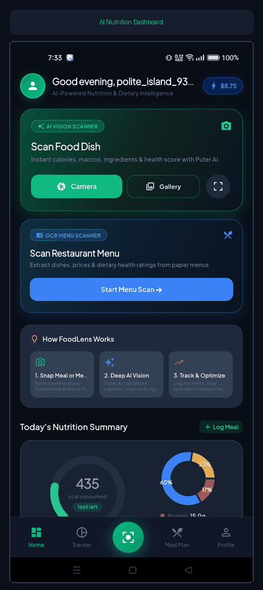
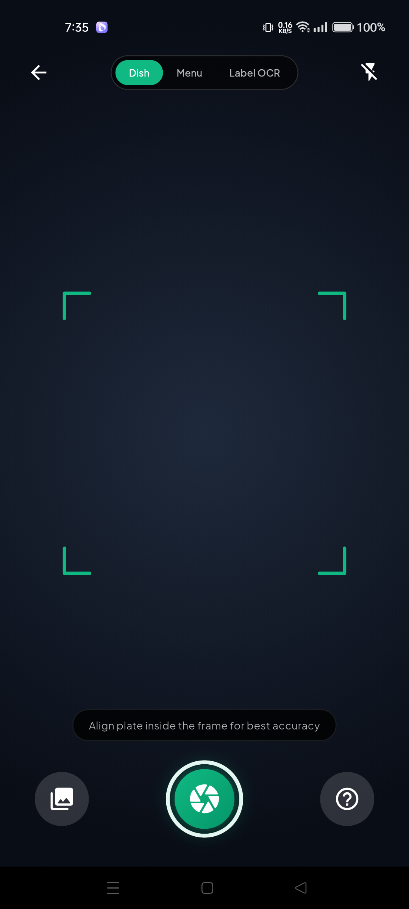
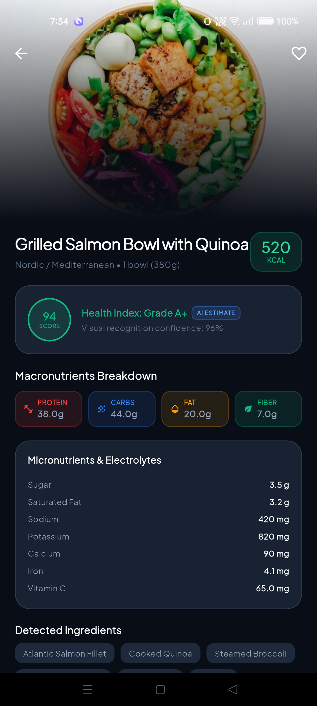
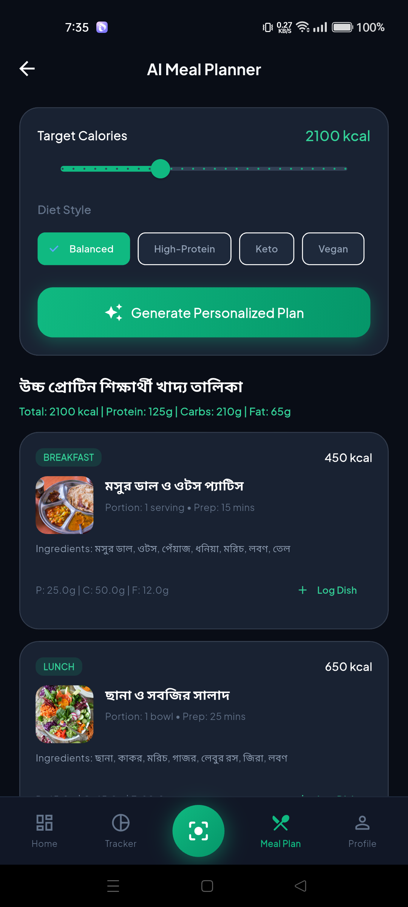
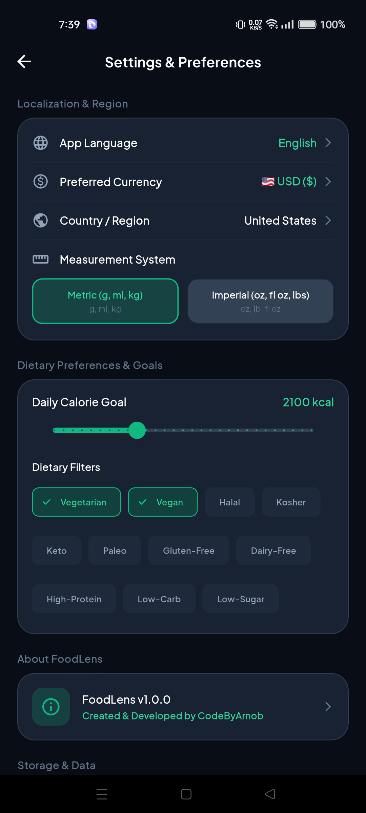
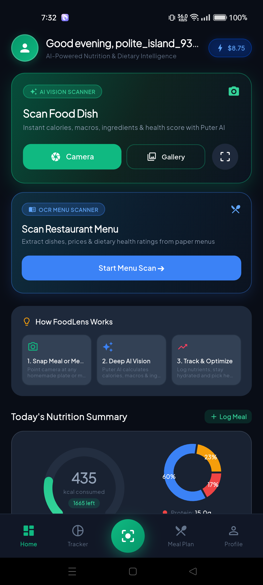
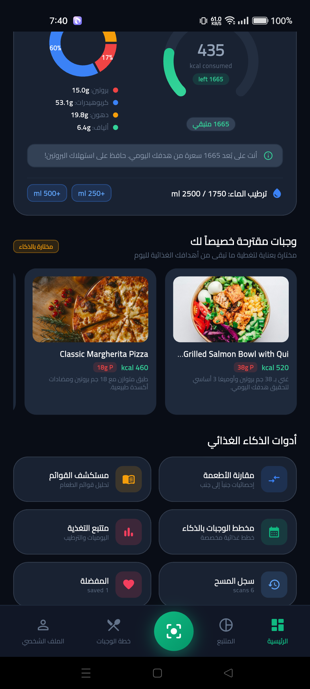
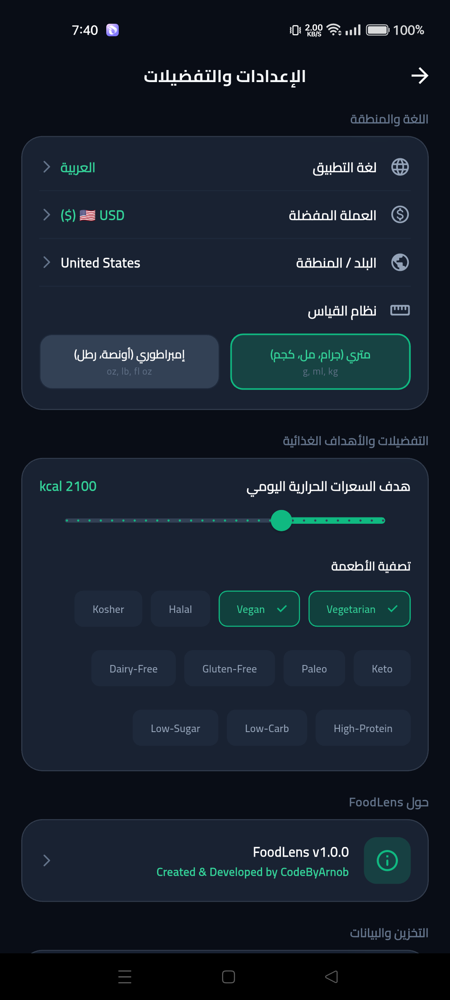
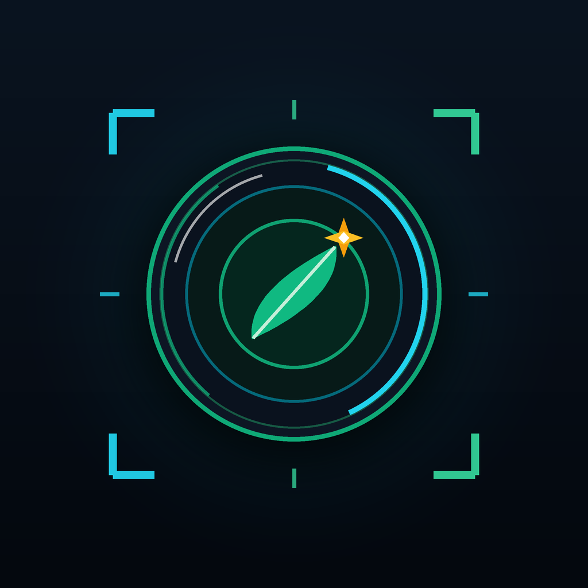
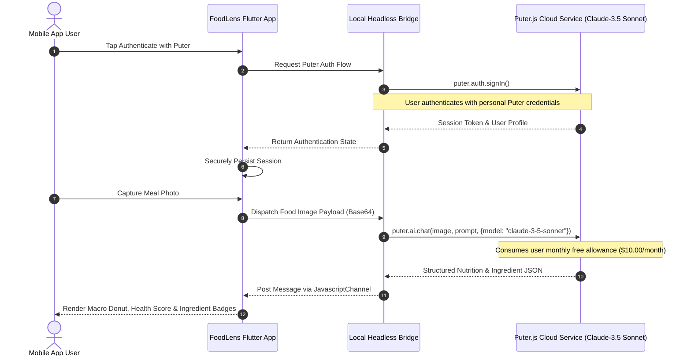

<div align="center">

# 🥗 FoodLens

### *Global AI-Powered Food Intelligence, Computer Vision Nutrition Analysis & Automated Meal Planning*

[](https://github.com/CodeByArnob/FoodLens/releases/latest)
[](https://codebyarnob.github.io/FoodLens/)
[](https://github.com/CodeByArnob/FoodLens/releases/download/v1.0.0/app-release.apk)
[](https://github.com/CodeByArnob/FoodLens/actions)
[](https://flutter.dev)
[](https://dart.dev)
[](LICENSE)
[-3DDC84?style=for-the-badge&logo=android&logoColor=white)](https://android.com)
[](https://github.com/CodeByArnob)

<br/>

<a href="https://github.com/CodeByArnob/FoodLens/releases/download/v1.0.0/app-release.apk">
  
</a>
<a href="https://codebyarnob.github.io/FoodLens/">
  
</a>

<br/><br/>

<p align="center">
  
</p>

*Empowering healthy living through instant visual food recognition, clinical macronutrient tracking, allergen safety screening, and decentralized client-side AI computing.*

</div>

---

> [!IMPORTANT]
> ### 🤝 FoodLens Open Source Contributions: Help Wanted!
> 
> **Puter Login ও Sign Up সরাসরি Android Default External Browser-এ ওপেন করা এবং Session Persistence নিশ্চিত করার জন্য অভিজ্ঞ ডেভেলপারদের আমন্ত্রণ।**
> 
> We are actively inviting global developers to collaborate on FoodLens. We are particularly seeking contributions in the following domains:
> - 📱 **Flutter / Dart Architecture**: Reactive Riverpod state resilience, high-fps UI animations, and smooth chart rendering.
> - 🔐 **External Browser Puter Authentication**: Enabling Puter Login and Sign Up to launch directly in the user default Android external browser (Chrome, Firefox, or preferred browser) and returning securely to FoodLens with session preserved.
> - ⚡ **Puter.js Integration**: Enhancing the headless JavaScript bridge, optimizing usage quota tracking, and ensuring persistent session restoration.
> - 📸 **AI Food Recognition**: Refining vision prompts, prompt tuning, and packaged FDA/EU label OCR precision.
> - 🌐 **Localization & RTL**: Expanding authentic translations for Bengali, Arabic (RTL), Hindi, Spanish, French, German, and Japanese.
> 
> 🔗 **Active Help Wanted Issue**: [Help Wanted: Open Puter Login and Sign Up in the External Default Browser](https://github.com/CodeByArnob/FoodLens/issues/1)  
> 📖 **Troubleshooting Architecture Guide**: [`documentation/AUTHENTICATION_TROUBLESHOOTING.md`](documentation/AUTHENTICATION_TROUBLESHOOTING.md)  
> 🛠️ **Contributor Guidelines**: [`CONTRIBUTING.md`](CONTRIBUTING.md)

---

## 📑 Table of Contents

- [Overview and Vision](#overview-and-vision)
- [Official Website](#official-website)
- [Key Features](#key-features)
- [Genuine Application Screenshots](#genuine-application-screenshots)
- [Puter.js User-Pays Architecture](#puterjs-user-pays-architecture)
- [Authentication Troubleshooting and Open Challenges](#authentication-troubleshooting-and-open-challenges)
- [Supported Languages and Regional Currencies](#supported-languages-and-regional-currencies)
- [Technology Stack](#technology-stack)
- [Architecture and Directory Structure](#architecture-and-directory-structure)
- [Installation and Local Setup](#installation-and-local-setup)
- [Building and Installing the Release APK](#building-and-installing-the-release-apk)
- [Testing and Quality Assurance](#testing-and-quality-assurance)
- [Open Source Contributions](#open-source-contributions)
- [Food Safety and Medical Disclaimer](#food-safety-and-medical-disclaimer)
- [Author and Community Credits](#author-and-community-credits)
- [Privacy Policy](#privacy-policy)
- [License](#license)

---

## 🌟 Overview and Vision

**FoodLens** is a next-generation open-source mobile application engineered with Flutter, designed to transform personal nutrition and dietary awareness. Using advanced multimodal computer vision and a decentralized **User-Pays** computing architecture powered by **Puter.js**, FoodLens enables users to instantly analyze food imagery, estimate macronutrients, identify allergens, and plan meals without subscription paywalls or privacy concessions.

### Core Values
1. **Decentralized User-Pays AI**: Every user authenticates with their own Puter account and utilizes their personal free monthly tier ($10.00 monthly quota). The application runs zero centralized backend servers, ensuring zero ongoing server costs for the open-source maintainers.
2. **Clinical Nutritional Precision**: Instant breakdown of calories, protein, carbohydrates, dietary fiber, fats, and glycemic estimates.
3. **Inclusive Global Accessibility**: Full localization across 7 languages, complete Right-to-Left (RTL) support for Arabic, dynamic regional currency conversion, and regional culinary recognition.
4. **Offline First Privacy**: Your dietary log, favorite recipes, and personal health metrics remain securely on your local device.

---

## 🌐 Official Website

Explore the FoodLens interactive landing page, features showcase, and live documentation:  
👉 **[https://codebyarnob.github.io/FoodLens/](https://codebyarnob.github.io/FoodLens/)**

---

## ✨ Key Features

### 📸 Intelligent Food Vision & Multimodal Scanner
- **Live Dish Recognition**: Capture a photo of any meal or select an existing image from your gallery. FoodLens identifies complex multi-ingredient dishes, side servings, and cooking styles.
- **Packaged Food Label OCR**: Point the scanner at packaged food labels to automatically parse Nutrition Facts panels, serving sizes, sodium levels, and hidden additives.
- **Restaurant Menu Analyzer**: Scan printed or digital dining menus to extract dishes, estimate calories, and highlight items compatible with your dietary goals.

### 📊 Macronutrient & Calorie Analytics
- **Dynamic Macro Rings**: Interactive charts visualizing daily caloric intake alongside Protein, Carbohydrates, and Fat distribution.
- **Health Score & Quality Rating**: Algorithmic scoring scale (1 to 100) and grade (A to E) assessing nutritional quality, fiber density, and processing level.
- **Hydration Tracking**: Log water consumption with quick-add increments and progress dials.

### 📅 Automated Meal Planning & Dietary Goals
- **Personalized Targets**: Configure individual goals for weight loss, muscle gain, diabetic blood sugar management, or balanced maintenance.
- **AI-Powered Meal Generation**: Generate breakfast, lunch, snack, and dinner suggestions customized to your calorie targets, dietary filters, and regional taste preferences.

---

## 📱 Genuine Application Screenshots

All screenshots below are captured directly from the actual running FoodLens application on a physical Android device (Realme 8, Android 13).

<table align="center">
  <tr>
    <td align="center" width="33%">
      <br/>
      <b>Home Dashboard</b><br/>
      <sub>Daily calories, macros, hydration, and quick actions</sub>
    </td>
    <td align="center" width="33%">
      <br/>
      <b>AI Food Scanner</b><br/>
      <sub>Dish detection, label OCR, and menu analysis</sub>
    </td>
    <td align="center" width="33%">
      <br/>
      <b>Nutrition Analysis</b><br/>
      <sub>Detailed macros, health score, and ingredients</sub>
    </td>
  </tr>
  <tr>
    <td align="center" width="33%">
      <br/>
      <b>Meal Planner</b><br/>
      <sub>AI recommendations and calorie-budgeted plans</sub>
    </td>
    <td align="center" width="33%">
      <br/>
      <b>Application Settings</b><br/>
      <sub>Profile, Puter authentication, and currency conversion</sub>
    </td>
    <td align="center" width="33%">
      <br/>
      <b>Bengali Localization</b><br/>
      <sub>Full Bengali language interface with authentic typography</sub>
    </td>
  </tr>
  <tr>
    <td align="center" width="33%">
      <br/>
      <b>Arabic RTL Dashboard</b><br/>
      <sub>Complete Right-to-Left bidirectional layout</sub>
    </td>
    <td align="center" width="33%">
      <br/>
      <b>Arabic RTL Settings</b><br/>
      <sub>Right-aligned controls, Arabic numerals, and Cairo typography</sub>
    </td>
    <td align="center" width="33%">
      <br/>
      <b>FoodLens Identity</b><br/>
      <sub>Master 1024x1024 application brand icon</sub>
    </td>
  </tr>
</table>

---

## ⚡ Puter.js User-Pays Architecture

FoodLens is pioneering the **User-Pays open-source paradigm** for client-side artificial intelligence:



### Key Architectural Advantages
1. **Zero Infrastructure Overhead**: No cloud servers, proxies, or maintenance overhead for open-source maintainers.
2. **Individual User Sovereignty**: Each user brings their own monthly allowance provided by Puter ($10.00 USD/month free tier), with transparent in-app usage monitoring.
3. **Data Privacy**: Images and nutritional logs are processed ephemerally; user history resides locally on device in encrypted storage.

---

## 🔐 Authentication Troubleshooting and Open Challenges

> [!WARNING]
> **Puter Login and Sign Up external browser delegation currently has an OPEN investigation.** We are actively soliciting contributions from Flutter, Android, and browser integration developers.

For complete architectural details, reproduction steps, and error logs, please see:
👉 **[documentation/AUTHENTICATION_TROUBLESHOOTING.md](documentation/AUTHENTICATION_TROUBLESHOOTING.md)**

### Key Open Issue Under Active Community Investigation:
1. **External Browser Delegation**: Enabling both Login and Sign Up buttons to launch the user default Android external browser (such as Chrome, Firefox, or Samsung Internet) rather than opening inside an internal embedded WebView.
2. **Session Return and Handshake**: Returning smoothly from the external browser back into FoodLens with the Puter account session recognized and persisted.
3. **Puter.js SDK Capabilities**: Researching official Puter.js redirect URI parameters, custom scheme deep linking, or mobile SDK patterns without compromising the decentralized User-Pays model.

Join the discussion and submit proposals on our [GitHub Issues](https://github.com/CodeByArnob/FoodLens/issues/1).

---

## 🌍 Supported Languages and Regional Currencies

FoodLens offers native internationalization with dynamic in-app locale switching:

### Supported Languages
| Code | Language | Native Name | Script Direction | Typography Engine |
| :---: | :---: | :---: | :---: | :---: |
| `en` | **English** | English | Left-to-Right (LTR) | Material Inter |
| `bn` | **Bengali** | বাংলা | Left-to-Right (LTR) | GoogleFonts.hindSiliguri |
| `ar` | **Arabic** | العربية | **Right-to-Left (RTL)** | GoogleFonts.cairo |
| `es` | **Spanish** | Español | Left-to-Right (LTR) | Material Inter |
| `fr` | **French** | Français | Left-to-Right (LTR) | Material Inter |
| `de` | **German** | Deutsch | Left-to-Right (LTR) | Material Inter |
| `ja` | **Japanese** | 日本語 | Left-to-Right (LTR) | Noto Sans JP |
| `hi` | **Hindi** | हिन्दी | Left-to-Right (LTR) | Noto Sans Devanagari |

### Regional Currency and Numerical Conversion
FoodLens performs **live numerical currency conversion** using real exchange rates, displaying the regional currency alongside the reference value:

| Currency | Symbol | Regional Jurisdiction | Example Menu Pricing |
| :---: | :---: | :---: | :---: |
| **USD** | `$` | United States | `$ 14.50` |
| **BDT** | `৳` | Bangladesh | `৳ 1,776.25 ($ 14.50)` |
| **EUR** | `€` | European Union | `€ 13.34 ($ 14.50)` |
| **GBP** | `£` | United Kingdom | `£ 11.45 ($ 14.50)` |
| **INR** | `₹` | India | `₹ 1,203.50 ($ 14.50)` |
| **SAR** | `ر.س` | Saudi Arabia | `ر.س 54.38 ($ 14.50)` |
| **AED** | `د.إ` | United Arab Emirates | `د.إ 53.25 ($ 14.50)` |
| **JPY** | `¥` | Japan | `¥ 2,218 ($ 14.50)` |

---

## 🛠️ Technology Stack

| Layer | Technology | Version | Purpose |
| :---: | :---: | :---: | :---: |
| **Core Framework** | **Flutter** | `3.29.0+` | Cross-platform native compilation and rendering |
| **Language** | **Dart** | `3.7.0+` | Strong type safety, pattern matching, and async runtimes |
| **State Management** | **Flutter Riverpod** | `3.4.3` | Reactive, testable, and compile-safe state management |
| **Navigation** | **GoRouter** | `17.5.0` | Declarative routing with `StatefulShellRoute` preservation |
| **Visual Charts** | **fl_chart** | `1.3.0` | High-performance interactive donut and gauge charts |
| **Decentralized AI** | **Puter.js Bridge** | `v2` | User-Pays client-side cloud LLM and Vision inference |
| **Web Integration** | **webview_flutter** | `4.14.1` | Native Android WebView bridge for Puter authentication |
| **Image Pipeline** | **image_picker** | `1.2.4` | Direct physical camera acquisition and gallery selection |
| **Internationalization** | **flutter_localizations** | SDK | ARB-based localization with RTL text direction support |
| **Typography** | **google_fonts** | `8.2.1` | Dynamic typography (Hind Siliguri, Cairo, Inter) |
| **Persistence** | **shared_preferences** | `2.5.6` | Encrypted local storage for history, logs, and settings |

---

## 🏛️ Architecture and Directory Structure

FoodLens adheres strictly to **Clean Architecture** and feature-first module separation:

```
FoodLens/
├── .github/
│   ├── ISSUE_TEMPLATE/            # Standardized issue templates
│   └── workflows/
│       ├── flutter_ci.yml         # Automated GitHub Actions CI/CD Pipeline
│       └── deploy_pages.yml       # Official GitHub Pages deployment workflow
├── android/                       # Native Android configuration and manifest
├── assets/
│   ├── data/                      # Local offline nutritional JSON database
│   ├── html/                      # Puter.js JavaScript bridge HTML
│   ├── icons/                     # Master brand launcher icons (1024x1024)
│   └── images/                    # Curated sample dish imagery
├── docs/                          # Official GitHub Pages website
│   ├── assets/                    # Website branding, screenshots, and demo GIF
│   ├── index.html                 # Responsive landing page
│   ├── styles.css                 # Premium dark mode theme
│   └── app.js                     # Interactive navigation and controls
├── documentation/
│   ├── AUTHENTICATION_TROUBLESHOOTING.md # Puter external browser architecture guide
│   └── assets/                    # Official documentation assets
│       ├── branding/              # High-res logos and iconography
│       ├── demo/                  # Animated product demonstration GIF
│       └── screenshots/           # Genuine physical-device screenshot gallery
├── lib/
│   ├── core/                      # Shared constants, theme, routing, and utilities
│   │   ├── constants/             # AppColors, DietaryConstants, AppConstants
│   │   ├── errors/                # Typed exception hierarchy
│   │   ├── router/                # Declarative GoRouter configuration
│   │   ├── services/              # Currency exchange service and formatters
│   │   ├── theme/                 # Material 3 light/dark themes
│   │   └── utils/                 # Haptics, unit converters, localization helpers
│   ├── features/                  # Domain-specific application modules
│   │   ├── auth/                  # Puter.js bridge, usage tracking, and auth screens
│   │   ├── comparison/            # Nutritional comparison engine
│   │   ├── dashboard/             # Main navigation shell and Home dashboard
│   │   ├── history_favorites/     # Meal history and favorites persistence
│   │   ├── meal_planner/          # Calorie-target meal planning
│   │   ├── menu_explorer/         # Restaurant menu item exploration
│   │   ├── nutrition_tracking/    # Daily logs, macro dials, and hydration
│   │   ├── scanner/               # Camera viewfinder, OCR label, and dish analysis
│   │   └── settings/              # Regional preferences, units, and language controls
│   ├── l10n/                      # ARB localization definitions (en, bn, ar, etc.)
│   ├── shared/                    # Reusable UI widgets and storage services
│   └── main.dart                  # Application entry point and ProviderScope root
├── test/
│   ├── unit_test.dart             # Logic, conversion, and model test suite
│   └── widget_test.dart           # Widget rendering and interaction tests
├── CODE_OF_CONDUCT.md            # Contributor Covenant Code of Conduct
├── SECURITY.md                    # Security disclosure policy
├── PRIVACY.md                     # Privacy policy and zero telemetry terms
├── CONTRIBUTING.md                # Open source contribution guide
├── CHANGELOG.md                   # Version history and release notes
├── pubspec.yaml                   # Dependency definitions and Flutter assets
└── LICENSE                        # MIT Open Source License
```

---

## 💻 Installation and Local Setup

### Prerequisites
- **Flutter SDK**: `3.29.0` or later
- **Dart SDK**: `3.7.0` or later
- **Android SDK**: API 34+ (compileSdkVersion 34, minSdkVersion 24)
- **Java Development Kit**: JDK 17

### 1. Clone the Repository
```bash
git clone https://github.com/CodeByArnob/FoodLens.git
cd FoodLens
```

### 2. Install Dependencies
```bash
flutter pub get
```

### 3. Generate Localizations
```bash
flutter gen-l10n
```

### 4. Run Static Code Analysis
```bash
flutter analyze
```

### 5. Run Local Test Suite
```bash
flutter test
```

### 6. Launch Debug Session on Device
```bash
flutter run
```

---

## 📦 Building and Installing the Release APK

### Download Pre-Built Release APK
You can directly download the official verified Android Release APK from the [Latest Release](https://github.com/CodeByArnob/FoodLens/releases/latest):
👉 **[Download FoodLens v1.0.0 APK](https://github.com/CodeByArnob/FoodLens/releases/download/v1.0.0/app-release.apk)** *(56.4 MB • Universal Android 7.0+)*

### Build Locally from Source
To compile the standalone production release APK locally:
```bash
flutter build apk --release
```
The compiled binary will be generated at:
```
build/app/outputs/flutter-apk/app-release.apk
```

### Install onto Connected Android Device via ADB
```bash
adb install -r build/app/outputs/flutter-apk/app-release.apk
```

---

## 🧪 Testing and Quality Assurance

FoodLens maintains high test coverage across unit converters, localization strings, currency formatters, state providers, and widget rendering:

```bash
flutter test --reporter expanded
```

All 24 test suites pass cleanly across both unit and widget specifications:
```
00:00 +0: UnitConverter Tests gramsToOunces correctly converts
00:00 +1: UnitConverter Tests formatWeight formats metric and imperial
00:00 +2: Puter Models Tests PuterUsage default free tier values
00:00 +3: Food Analysis & Intelligence Models FoodAnalysisResult parses correctly
00:00 +4: CurrencyFormatter Tests converts USD amount to BDT with symbol ৳
00:00 +5: Localization Tests AppLocalizationsBn provides authentic Bengali translations
00:00 +6: CalorieGauge widget renders correctly
00:01 +24: All tests passed!
```

---

## 🤝 Open Source Contributions

We warmly welcome contributions from developers worldwide. Check out [CONTRIBUTING.md](CONTRIBUTING.md) for full instructions on setting up your local environment, coding standards, and opening pull requests.

### Ways You Can Contribute:
1. **Solve Open Authentication Challenges**: Investigate Puter Login and Sign Up external browser delegation and session persistence.
2. **Translate to More Languages**: Help us translate FoodLens into additional regional languages via `.arb` files in `lib/l10n/`.
3. **Enhance AI Prompts and Offline Recognition**: Improve accuracy for regional dishes, spices, and complex culinary items.
4. **Report Bugs and Suggest Features**: Open an issue using our [GitHub Issue Templates](https://github.com/CodeByArnob/FoodLens/issues/new/choose).

---

## ⚠️ Food Safety and Medical Disclaimer

> [!WARNING]
> **FoodLens is designed exclusively for educational, nutritional awareness, and lifestyle planning purposes.**
> 
> * **Not Medical Advice**: FoodLens does not provide clinical diagnosis, medical treatment, or personalized healthcare prescriptions. Always consult a registered dietitian, physician, or certified medical specialist before initiating any major dietary restriction or health regimen.
> * **Cross-Contamination and Allergens**: Visual camera estimation and OCR scanning cannot identify microscopic traces of allergens, industrial cross-contamination, food-borne pathogens, or unlisted restaurant kitchen ingredients. If you suffer from severe food allergies (for example, celiac disease or anaphylactic peanut allergies), never rely on automated camera scanning as your safety verification.

---

## 👨‍💻 Author and Community Credits

FoodLens was conceived, architected, and built from the ground up by:

* **Author and Lead Maintainer**: **[CodeByArnob](https://github.com/CodeByArnob)** (Arnob)
* **Official Repository**: [https://github.com/CodeByArnob/FoodLens](https://github.com/CodeByArnob/FoodLens)
* **Official Website**: [https://codebyarnob.github.io/FoodLens/](https://codebyarnob.github.io/FoodLens/)
* **Contributions**: Pull requests, issues, and feature proposals are enthusiastically welcomed. Check out [CONTRIBUTING.md](CONTRIBUTING.md) to get started.

---

## 🔒 Privacy Policy

FoodLens is built around a zero telemetry and decentralized User-Pays architecture. User dietary logs and history reside locally on device in encrypted storage. Food imagery is processed ephemerally without central developer server retention.

Read our complete [Privacy Policy](PRIVACY.md) or visit our [Web Privacy Policy](https://codebyarnob.github.io/FoodLens/privacy.html).

---

## 📜 License

This project is licensed under the **MIT License**, see the [LICENSE](LICENSE) file for complete details.

<div align="center">
  <sub>Built with passion for global health and food intelligence by <b><a href="https://github.com/CodeByArnob">CodeByArnob</a></b> ❤️</sub>
</div>
